<div align="center">


# Isko-nnect

**Your comprehensive student services platform for the University of the Philippines Cebu.**

One desktop app for announcements, events, scholarships, tutoring, internships and room booking.

</div>

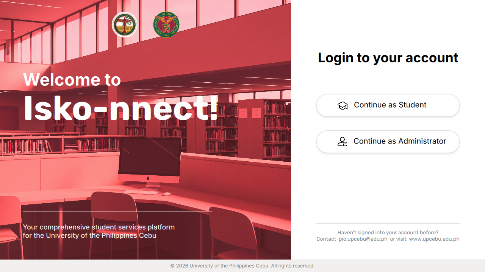


## Why Isko-nnect

Student services at UP Cebu are spread across Facebook pages, bulletin boards, emails and separate offices. Isko-nnect puts them in one place. Students see everything they can apply for or book, and administrators manage it all from a single dashboard.


## Two ways in

Students sign in with their name and 9-digit student number. Administrators sign in with a UP email address.

<table>
  <tr>
    <td width="50%">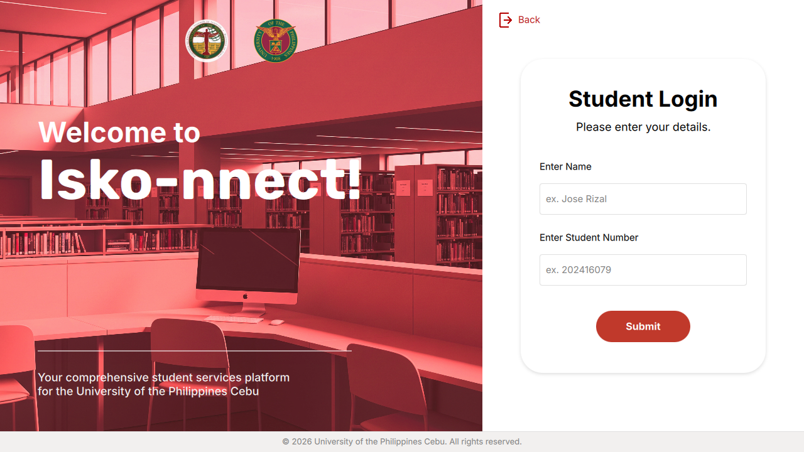</td>
    <td width="50%"></td>
  </tr>
  <tr>
    <td align="center"><sub>Student login</sub></td>
    <td align="center"><sub>Admin login</sub></td>
  </tr>
</table>


## For students

### Dashboard

Announcements, upcoming events and shortcuts to every service, the moment you sign in.

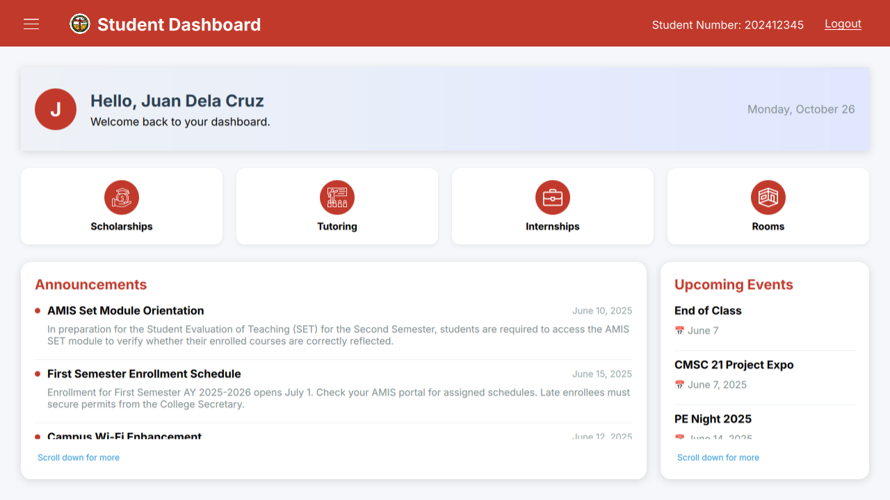

### Scholarships

Browse open scholarships with deadlines, eligible courses, year level and financial need. Filter by program or year, or search by name.

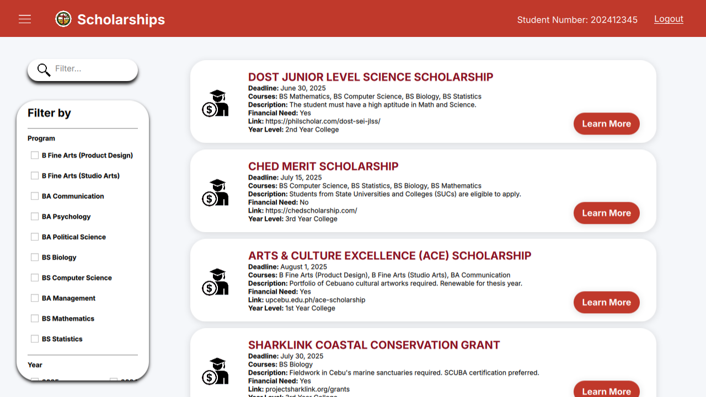

### Tutoring

Request a tutor from the list of approved student tutors, or apply to become one.

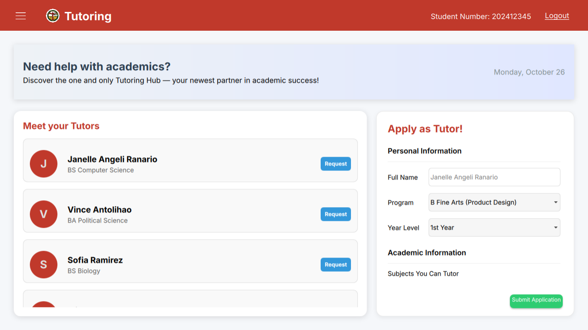

### Internships

Find internships that match your program and year level.

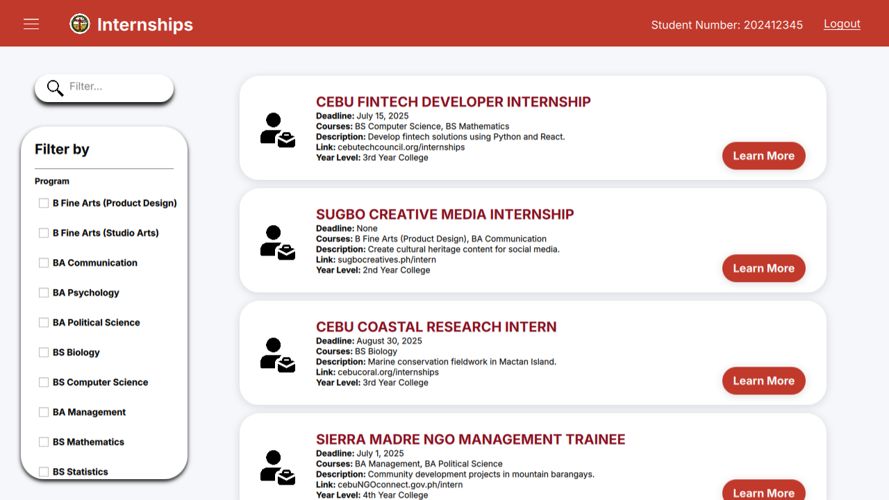

### Rooms

See every campus room with its type and capacity, then book one for a time slot.

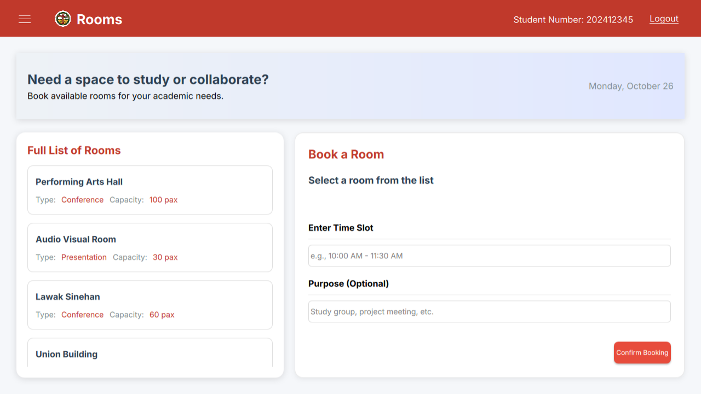


## For administrators

### Dashboard

Every service has its own management page.

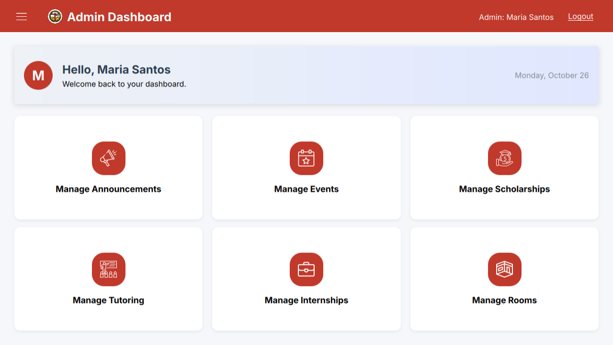

### Manage everything

Post announcements and events, add scholarships and internships, approve tutor applications and handle requests, and add rooms or mark them as booked.

<table>
  <tr>
    <td width="50%">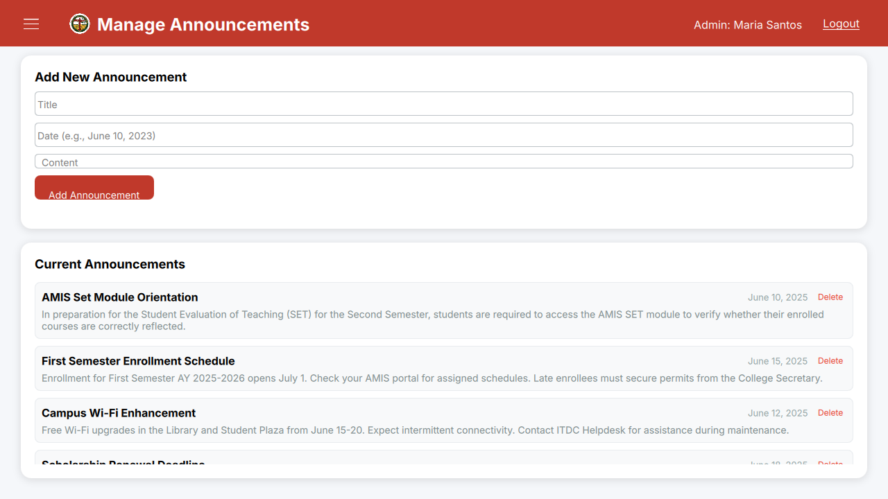</td>
    <td width="50%">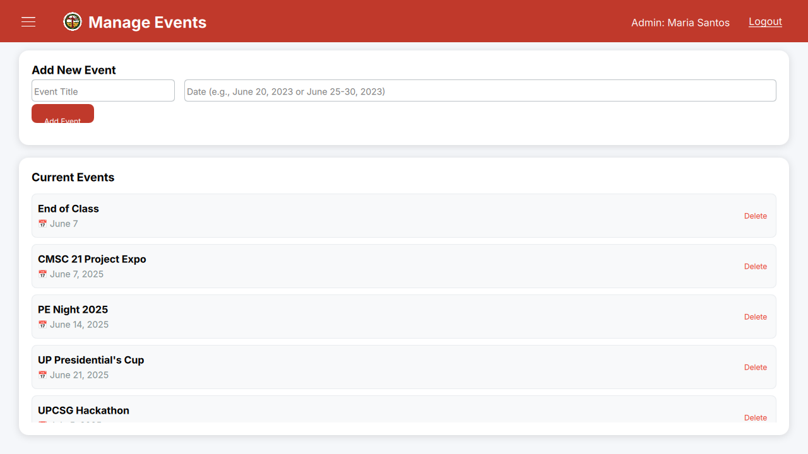</td>
  </tr>
  <tr>
    <td align="center"><sub>Announcements</sub></td>
    <td align="center"><sub>Events</sub></td>
  </tr>
  <tr>
    <td>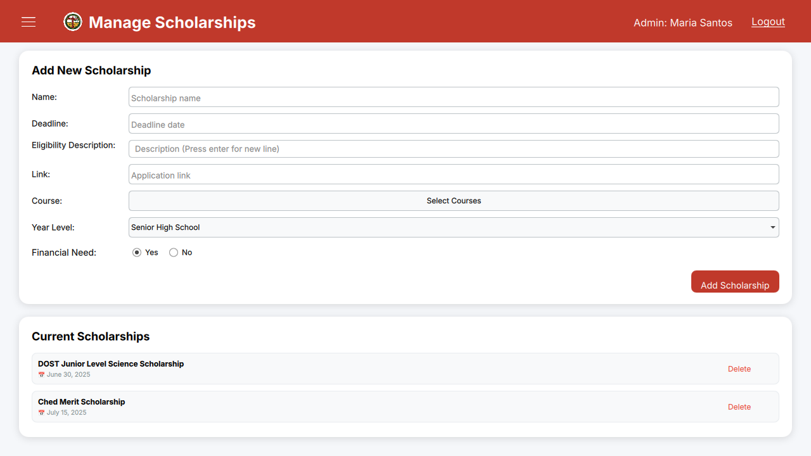</td>
    <td>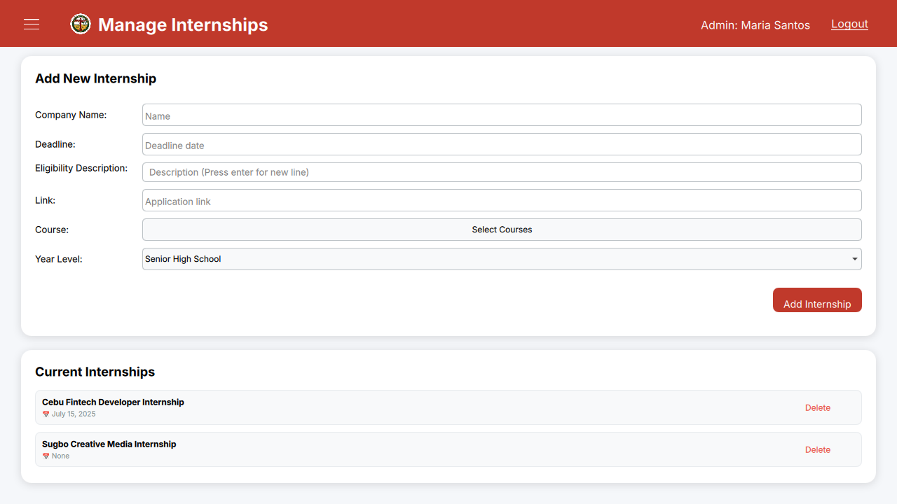</td>
  </tr>
  <tr>
    <td align="center"><sub>Scholarships</sub></td>
    <td align="center"><sub>Internships</sub></td>
  </tr>
  <tr>
    <td>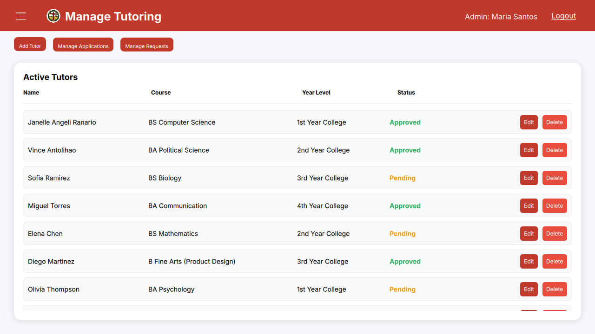</td>
    <td>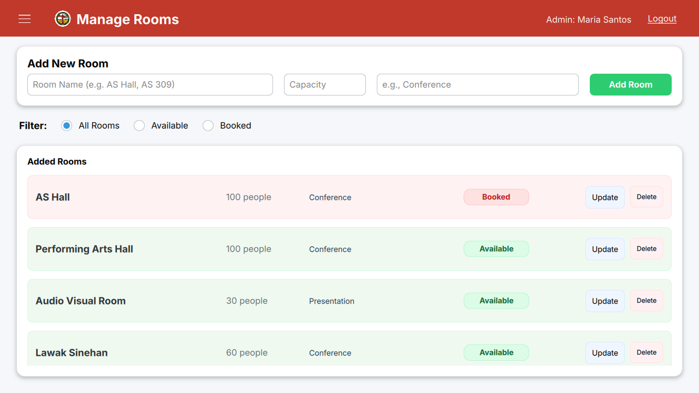</td>
  </tr>
  <tr>
    <td align="center"><sub>Tutoring</sub></td>
    <td align="center"><sub>Rooms</sub></td>
  </tr>
</table>


## How it's built

The interface is written in **QML** and the logic in **C++** with **Qt 6**. A C++ `FileManager` class is exposed to QML and reads and writes all app data as **JSON files**: one file each for announcements, events, scholarships, internships, tutors, tutor applications, tutor requests and rooms. A change an admin makes shows up on the student side right away.

<details>
<summary><b>Project structure</b></summary>

```
Isko-nnect/
├── main.cpp              # starts the app and registers FileManager for QML
├── main.qml              # window and page switching
├── filemanager.h/.cpp    # reads and writes the JSON data files
├── qml.qrc               # bundles the QML, images and fonts
└── ui/
    ├── LeftWelcomePage/   # welcome panel
    ├── RightWelcomePage/  # choose student or admin
    ├── RightLogin/        # login forms
    ├── StudentDashboard/  # all student pages
    ├── AdminDashboard/    # all admin pages
    ├── BottomBar/         # footer
    └── assets/            # icons, photos, Inter and Rubik fonts
```

</details>

<details>
<summary><b>Run it locally</b></summary>

1. Install **Qt 6** with the **Qt 5 Compatibility Module** (used for drop shadows), and open `ISKONNECT.pro` in **Qt Creator**.
2. Build and run.
3. The app reads its JSON data files from the folder it runs in. Copy the sample `.json` files into your build folder to start with data.

</details>


<div align="center">
<sub>A student project for the University of the Philippines Cebu.</sub>
</div>
